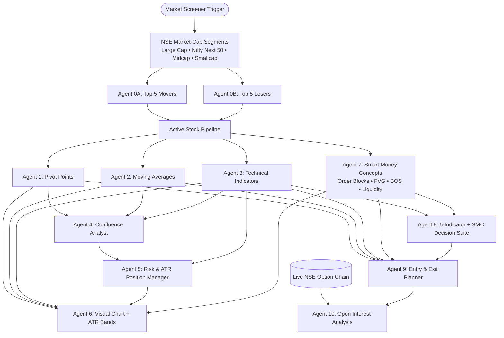

# 📈 Multi-Agent NSE Screener, Smart Money (SMC) & S&R Engine

A modular 12-agent quantitative technical analysis platform, Model Context Protocol (MCP) tool server, and 5-Tab Streamlit dashboard built for Indian equities (NSE/BSE).

> Decision support only, not financial advice. See [Backtest results](#-backtest-results) before relying on any signal.

---

## 🏗️ System Architecture



---

## 🚀 Quickstart

```bash
pip install -r requirements.txt
streamlit run app.py
```

### Dashboard Tabs
1. **Tab 1 (`Top 5 Movers & Losers`):** Scans Large Cap, Nifty Next 50, Midcap, and Smallcap indices via Agents 0A & 0B and sends selected stocks to Tabs 2 and 3.
2. **Tab 2 (`S&R, SMC & ATR Risk Setup`):** Displays Agent 6's candlestick chart with shaded custom ATR Risk/Target bands, ATR trailing stops, Agent 7's Smart Money Order Blocks, Pivots, MAs, Confluence zones, and Agent 5's position-sizing calculator.
3. **Tab 3 (`5 Best Indicators + SMC Decision Suite`):** Displays Agent 8's 6-signal Buy/Sell consensus scorecard (-6 to +6) alongside synchronized charts for Bollinger Bands + SMC zones, RSI (14), MACD (12,26,9), Stochastic (14,3), and ADX (14).
4. **Tab 4 (`Entry & Exit Plan`):** Agent 9 combines Agents 1, 2, 3, 5, 7 and 8 into a verdict (BUY, BUY ON PULLBACK, WAIT, AVOID), an entry price, stop-loss, two targets, position size and written exit rules.
5. **Tab 5 (`Open Interest Analysis`):** Agent 10 fetches the live NSE option chain and shows PCR, max pain, OI support/resistance, fresh put/call writing, a bullish/bearish condition checklist, OI charts, and whether OI confirms or conflicts with Agent 9.

Sidebar: trading capital, risk per trade %, and a **Skip SSL verification for NSE OI fetch** checkbox (needed on networks that intercept SSL, such as a corporate proxy). Default stock is `HDFCBANK`.

---

## 🧠 Agent 9: Entry & Exit Planner (`trade_planner.py`)

Long-only, rule-based.

- **Score:** Agent 8 score (-6 to +6) + moving-average alignment (-3 to +3), range -9 to +9.
- **Verdict:** 4 or more = BUY; 2 to 3 = BUY ON PULLBACK; -1 to 1 = WAIT; -2 or less = AVOID / EXIT IF HOLDING. A BUY with RSI above 70 becomes BUY ON PULLBACK.
- **Entry:** current price for BUY; the nearest support below price for a pullback (pivots, EMAs, order block, FVG, SMC liquidity).
- **Stop-loss:** below the supporting level with a 0.5 ATR buffer.
- **Targets:** nearest resistances giving at least 1R and 2R; falls back to 1R and 2R from entry.
- **Exit rules:** hard stop; sell half at Target 1 and move the stop to entry; exit the rest at Target 2 or a 2 ATR trail; exit early on a close below the 20 EMA after Target 1 or a bearish MACD cross.
- `build_hp_plan()` is an experimental "high-probability" variant with stricter filters. It is **not wired into the UI** because it did not pass backtesting.

## 🧮 Agent 10: Open Interest Analysis (`oi_tools.py`)

- **Source:** live NSE option chain (`option-chain-contract-info` and `option-chain-v3`), read-only GET requests. Only F&O stocks have a chain (for example HDFCBANK yes, MOREPENLAB no).
- **Checks (each bullish, bearish or neutral):** PCR (OI), OI change today, price + OI buildup, position within the OI support/resistance range, max-pain pull, ATM IV skew. Score range -6 to +6 gives the OI bias.
- **Limits:** option-chain OI only (no futures OI). NSE may rate-limit or block requests. Thresholds are heuristic.
- **Not backtested:** NSE exposes no historical option-chain OI. To backtest later, store a daily snapshot of the chain.

---

## 🧪 Backtest results

Scripts (run from this folder):

```bash
python backtest.py [SYMBOL ...]       # Agents 1-9 base plan, walk-forward, no look-ahead
python backtest_hp.py [SYMBOL ...]    # high-probability variant, train 2021-2023 / test 2024-2026
```

Outputs: `backtest_report.md`, `backtest_trades.csv`, `backtest_signal_quality.csv`, `backtest_hp_report.md`, `backtest_hp_trades.csv`, `backtest_snapshots.pkl` (cache).

Method: the real agent functions run on data cut at each decision day. Long-only, one position per stock, 0.2% round-trip cost, stop assumed first when stop and target hit on the same bar, pullback limit valid 10 days.

**Findings**
- Base plan, HDFCBANK only (before the Agent 8 BOS fix): 83 trades, 42% win rate, average R -0.07, profit factor 0.86, max drawdown 19%. Buy and hold returned +14.2% over the same window.
- High-probability variant, 10 large-cap stocks, parameters chosen on train only: train win rate 55-61% with average R about -0.05 to 0; test (2024-2026) win rate 45-54% with average R -0.22 to -0.33. No setting was profitable, so none was selected.
- **Conclusion:** the stacked price indicators (pivots, MAs, RSI, MACD, SMC) do not show an edge, and the 55-80% win-rate goal was not met. The full 10-stock run of `backtest.py` was interrupted and has no saved result.
- Next steps under consideration: backtest each signal alone, add independent inputs (relative strength, sector trend, delivery %), or change the risk profile.

---

## 🗂️ Files

| File | Purpose |
|---|---|
| `app.py` | Streamlit dashboard (5 tabs) |
| `market_tools.py` | Agents 1-8 (also exposed as MCP tools) |
| `screener_tools.py` | Agents 0A and 0B |
| `trade_planner.py` | Agent 9 (`build_trade_plan`, experimental `build_hp_plan`) |
| `oi_tools.py` | Agent 10 (`fetch_option_chain`, `analyze_oi`) |
| `backtest.py`, `backtest_hp.py` | Backtesting scripts |

## 🔧 Change log

- Added Tab 4 (Agent 9) and Tab 5 (Agent 10).
- Fixed Agent 8 SMC signal: it searched for `"Bullish BOS"` / `"Bearish BOS"`, but the market-structure text is `"Bullish Break of Structure (BOS)"`, so a BOS never scored. It now matches the real text.
- Default stock changed from `MOREPENLAB` to `HDFCBANK` (MOREPENLAB has no option chain).
- Added backtest scripts.
